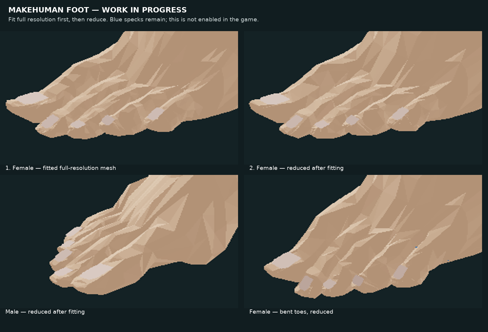

# MakeHuman feet — work in progress

The blue skeletons use the **original-resolution MakeHuman foot cut** in the
room. Width and heel-to-toe length are fitted separately, then the whole mesh
is rotated and positioned relative to the heel and the five distal toes. A
sequence of sex-specific whole-mesh scales, rotations and translations was
calibrated against blue foot-bone surfaces in the default standing and selected
toe-bend poses. The refinements exclude tibia and fibula. Corrections scale
with the foot and are mirrored on the right. A female-only adjustment shortens
the foot by 5% along the heel-to-toe axis and repositions it around the standing
bones. The male fit is unchanged; there is no per-frame optimizer.

Individual toe-length ratios are applied to the female skin after the whole-foot
fit. Original MakeHuman bone weights and a smooth root-to-tip ramp localize the
deformation, while the connecting foot stays in place. The female great, second
and third toes were shortened independently for the standing bones. The female
blue toes also have reference-angle adjustments about their bone contacts; distal
bones follow the joint rotations. The white CT is unchanged. Two bone influences
animate the skin, and the preview is 50% opaque. Original triangles and smooth
vertex shading are retained; there is no simplification, plane fit or procedural
nail overlay.

This is not a finished fit. Default standing exports of both feet have no
foot-bone surface crossings, but some female toe bends still cross the skin,
and **0.1 mm clearance is not guaranteed**, including at rest or in ragdoll.
The MakeHuman source and its CC0 license are in `tools/human-source/`.

## Earlier fitting experiment (not the in-game foot)



The following historical steps reproduce a **different, deformed and reduced**
mesh. These offsets and the results of its sampled-pose checks do not apply to
the current unmodified foot preview.

## Reproducing the offline data

Install NumPy, SciPy, trimesh, rtree, networkx, python-fcl and
fast-simplification. Compile `export-fit.cpp` and `export-pose.cpp` against the
native client objects (C++20) and run from the repository root. Replace the
uppercase names below with directories/files outside the repository:

1. Extract and fit full resolution at the default pose:

   ```
   python3 tools/foot/extract-makehuman-foot.py
   export-fit FIT
   python3 tools/foot/fit-bone-clearance.py FIT/m_L
   python3 tools/foot/fit-bone-clearance.py FIT/f_L
   ```

2. Recompile `export-pose` after regenerating headers. Export the fitted high
   mesh **without** prior pose offsets, fit the pose set, and write offsets:

   ```
   export-pose HIGH_POSES --base-only --sweep
   python3 tools/foot/fit-poses.py HIGH_POSES m MALE_BASIC --ignore-ankle --small-only --basic-only
   python3 tools/foot/fit-poses.py HIGH_POSES f FEMALE_BASIC --ignore-ankle --small-only --basic-only
   python3 tools/foot/fit-poses.py HIGH_POSES m MALE_TOES --ignore-ankle --small-only --initial MALE_BASIC
   python3 tools/foot/fit-poses.py HIGH_POSES f FEMALE_TOES --ignore-ankle --small-only --initial FEMALE_BASIC
   python3 tools/foot/fit-poses.py HIGH_POSES m MALE_HIGH_OFFSETS --initial MALE_TOES
   python3 tools/foot/fit-poses.py HIGH_POSES f FEMALE_HIGH_OFFSETS --initial FEMALE_TOES
   python3 tools/foot/apply-pose-correction.py FIT/m_L HIGH_POSES/m0_L-rest MALE_HIGH_OFFSETS
   python3 tools/foot/apply-pose-correction.py FIT/f_L HIGH_POSES/f0_L-rest FEMALE_HIGH_OFFSETS
   ```

3. Reduce those fitted meshes, compile `export-pose` again, and fit the reduced
   meshes with high-resolution pose offsets enabled but reduced offsets disabled:

   ```
   python3 tools/foot/simplify-fitted-foot.py FIT/m_L --fitted skin-pose-fitted.obj
   python3 tools/foot/simplify-fitted-foot.py FIT/f_L --fitted skin-pose-fitted.obj
   export-pose LOW_POSES --reduced --base-only --sweep
   python3 tools/foot/fit-poses.py LOW_POSES m MALE_LOW_OFFSETS
   python3 tools/foot/fit-poses.py LOW_POSES f FEMALE_LOW_OFFSETS
   python3 tools/foot/apply-reduced-pose-correction.py LOW_POSES/m0_L-rest MALE_LOW_OFFSETS
   python3 tools/foot/apply-reduced-pose-correction.py LOW_POSES/f0_L-rest FEMALE_LOW_OFFSETS
   ```

4. Recompile the exporter and verify **fresh** exports with all offsets applied:

   ```
   export-pose HIGH_FINAL --sweep
   export-pose LOW_FINAL --reduced --sweep
   python3 tools/foot/check-clearance.py HIGH_FINAL
   python3 tools/foot/check-clearance.py LOW_FINAL
   ```

`render-progress.cpp` renders both sexes, both sides, rest/bent poses and four
angles; run `render-progress OUTPUT [--reduced]` after compiling. The body source
is `tools/human-source/`, its license is `tools/human-source/CC0.txt`, and
`NOTICE.md` contains attribution.
